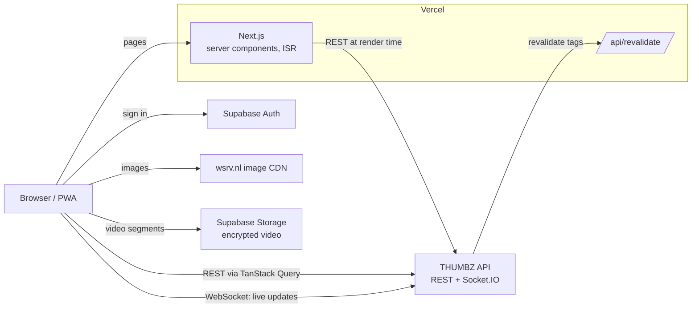
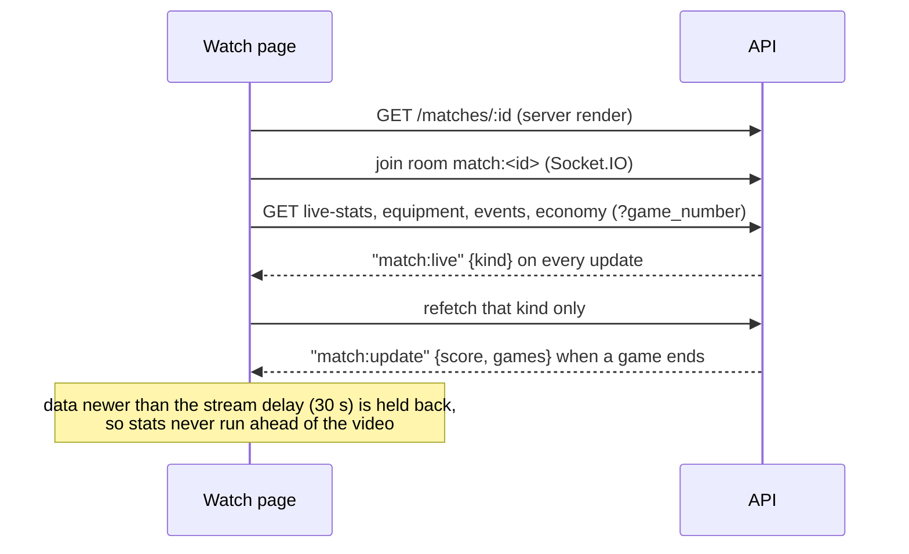

# thumbz-next-client

Web app for **THUMBZ**, a Mobile Legends: Bang Bang (MLBB) esports companion.
Watch matches live with realtime stats and chat, rewatch protected replays
game by game (builds, emblems, talents, the full item sequence), buy venue
tickets with QRIS, bank virtual account or crypto, search everything, and get
match reminders. It installs as a PWA on Android, iOS and desktop.

- **Live site:** https://thumbz-next-client.vercel.app
- **API:** [`thumbz-server`](../thumbz-server). Its contract,
  `thumbz-server/docs/API-CONTRACT.md`, is the boundary; types are generated
  from its OpenAPI document (`npm run gen:api`).

Next.js 15 (App Router) · React 19 · TypeScript · TanStack Query · Tailwind 4 ·
Supabase Auth · Socket.IO · shaka-player · Playwright · Vitest · Vercel.

## What you can do

| Page | Route | What's there |
| --- | --- | --- |
| Home | `/` | Featured live match (hero), match center with gold lead and key moments, schedule, replays |
| Live | `/live` | Every match on air |
| Matches | `/matches`, `/matches/[id]` | Numbered, shareable list; the watch page: stream, chat, moments, per-game stats with hero/item icons and the item sequence, tickets |
| Replays | `/videos`, `/videos/[id]` | Infinite feed; player with DRM, quality menu, PiP |
| Tournaments, teams, players | `/tournaments`, `/teams`, `/players` (+ `[id]`) | Standings, rosters, form and results |
| Search | `/search?q=` | Typo-tolerant, deep-linkable; ⌘K palette everywhere |
| Account | `/login`, `/profile`, `/favorites`, `/history`, `/me/tickets`, `/me/orders` | Sign in, followed teams, watch history, tickets (QR) and orders, match reminders |

Spoiler-free mode hides scores and results across the app until you reveal a
match.

## How it works



- **Public pages** render on the server and are cached (ISR). When data
  changes, the API calls `/api/revalidate` with tags, so pages refresh
  without waiting for their timer.
- **Personal and live parts** (chat, live stats, tickets, account) load in
  the browser with TanStack Query.
- **Realtime:** one Socket.IO connection, joined to rooms (`match:<id>`).
  A push like `match:live {kind: "live-stats"}` refetches only that resource.
  A missed message (sequence gap) resyncs from REST, and the app only polls
  while the socket is down.

### Live match page



### Checkout

1. Pick a payment method on an upcoming match (QRIS, bank VA, crypto).
2. Reserve: the API holds the seats for a few minutes.
3. Pay: the app shows the QR (rendered in the browser), the VA number or the
   crypto address.
4. The payment status arrives over the socket; tickets appear with their QR
   codes under **My tickets**.

Retries are idempotent (an `Idempotency-Key` per attempt), so a double click
never buys twice. In the demo the API runs a sandbox gateway with a
"Simulate payment" button.

## Project structure

```text
src/
  app/                  routes (App Router), metadata, sitemap, /api/revalidate, /api/vitals
  components/
    match/              watch page: LiveStats, ItemTimeline, GoldLead, chat, moments
    home/, cards/, tournaments/, search/, video/, checkout/, account/, pwa/
    ui/                 shared building blocks (buttons, tabs, pagination, …)
  lib/
    api/                fetch client, endpoints + query keys, generated schema types
    realtime/           Socket.IO client and hooks
    player/             DRM / playback selection for shaka-player
    supabase/           Auth clients (browser + server)
    utils/              formatting, builds/inventory, games, search params
  middleware.ts         session refresh, protected routes
public/                 sw.js (service worker), manifest, icons
e2e/                    Playwright tests
docs/adr/               architecture decision records
```

## Getting started (local)

### Requirements

- Node 22 (`.nvmrc`; `nvm use`)
- A running THUMBZ API: local (see the server README) or the production API

### Run

```bash
npm ci
cp .env.example .env.local
npm run dev                    # http://localhost:3000
```

### Environment (`.env.local`)

| Variable | Value |
| --- | --- |
| `NEXT_PUBLIC_API_URL` | `http://localhost:3001/api/v1` for a local API, or `https://thumbz-server-production.up.railway.app/api/v1` |
| `NEXT_PUBLIC_SUPABASE_URL` | Supabase project URL (`http://127.0.0.1:44321` with `supabase start`) |
| `NEXT_PUBLIC_SUPABASE_ANON_KEY` | That project's anon / publishable key (never the service role key) |
| `REVALIDATE_SECRET` | Same value as the API's, so it can refresh cached pages |
| `NEXT_PUBLIC_SITE_URL` | Optional: canonical domain for metadata, sitemap and share cards |

The API must allow your origin: its `CORS_ORIGINS` needs
`http://localhost:3000` (or whichever port `next dev` picked).

### Production build locally

The service worker (offline page, push reminders) registers only in
production builds:

```bash
npm run build && npm start     # builds into .build/, serves on :3000
```

## Scripts

| Script | What it does |
| --- | --- |
| `npm run dev` | Dev server with hot reload |
| `npm run build` / `npm start` | Production build (into `.build/`) and server |
| `npm run lint`, `npm run typecheck` | ESLint, TypeScript |
| `npm run test`, `npm run test:cov` | Vitest unit and component tests |
| `npm run test:e2e` | Playwright against a running app + API |
| `npm run lighthouse` | Lighthouse CI with the budgets in `lighthouserc.json` |
| `npm run gen:api` | Regenerate API types from `../thumbz-server/openapi.json` |

## Engineering highlights

| Area | What | Where |
| --- | --- | --- |
| Rendering | ISR for public pages + on-demand revalidation by tag from the API; dynamic only where personal ([ADR 0001](docs/adr/0001-rendering-and-caching.md)) | `src/app/**/page.tsx`, `src/app/api/revalidate/` |
| Lists | Numbered, shareable pagination; infinite replay feed (keyset cursors, IntersectionObserver, "Load more" fallback, scroll restored on back) | `src/components/ui/Pagination.tsx`, `src/components/video/VideoFeed.tsx` |
| Search | Deep-linkable `/search?q=&type=&page=` (server-rendered), debounced URL updates, ⌘K command palette with suggestions | `src/app/search/`, `src/components/search/` |
| Realtime | Lazy Socket.IO client, rooms, sequence-gap detection → REST resync, polling only while disconnected | `src/lib/realtime/`, `src/components/match/LiveMatchProvider.tsx` |
| Match data | Real MPL PH week: per-game tabs, hero/item/emblem/talent icons, final builds, and an item-sequence timeline (each player's purchases as an ordered list for screen readers) | `src/components/match/LiveStats.tsx`, `src/components/match/ItemTimeline.tsx`, `src/lib/utils/builds.ts` |
| Video & DRM | shaka-player; picks Widevine/PlayReady → ClearKey → native HLS (Apple) → HLS via MSE; rotating playback tokens, heartbeats, device limit, quality menu, PiP, iOS fullscreen, keyboard shortcuts | `src/components/video/`, `src/lib/player/` |
| Checkout | QRIS (QR rendered client-side), bank VA, crypto; idempotent retries; payment status over the socket | `src/components/checkout/` |
| PWA | Manifest + maskable icons, hand-written service worker with offline fallback, install prompt / iOS steps, Web Push reminders ([ADR 0002](docs/adr/0002-hand-written-service-worker.md)) | `public/sw.js`, `src/components/pwa/`, `src/components/account/MatchReminders.tsx` |
| Speed | Navigation progress bar, route skeletons, lazy heavy components, image CDN loader (WebP, sized), preconnect, real-user Web Vitals to `/api/vitals` | `src/components/layout/`, `src/lib/image-loader.ts` |
| Cross-platform | `dvh`, safe areas, no input zoom on iOS, sticky bars under the header, `hover:hover` only | `src/app/globals.css` |
| Accessibility | Skip link, WAI-ARIA tabs with arrow keys, focus return, labelled controls, contrast fixed to AA | throughout |
| SEO | Metadata in `<head>`, title template, sitemap, robots, per-match Open Graph image, `SportsEvent` JSON-LD | `src/app/sitemap.ts`, `src/app/matches/[id]/` |
| Security | Images only through the CDN loader, security headers + CSP (report-only), safe `next` redirects, server-side `getClaims()` | `next.config.ts`, `src/middleware.ts` |

## Testing

| Suite | Command | Notes |
| --- | --- | --- |
| Lint + types | `npm run lint && npm run typecheck` | |
| Unit / component | `npm run test:cov` | Vitest + Testing Library; coverage floor on the logic layer |
| End to end | `npm run test:e2e` | Playwright: Desktop Chrome, Desktop Safari, iPhone, Pixel, against a running stack ([ADR 0003](docs/adr/0003-cross-browser-testing.md)) |
| Lighthouse | `npm run lighthouse` | Budgets in `lighthouserc.json` |

Local results on the production build: 52 e2e tests pass on all four browser
projects (5 skipped by design); Lighthouse accessibility, best practices and
SEO are 100 on the audited pages (`/search` is `noindex` on purpose).

End-to-end environment variables: `E2E_BASE_URL` (default
`http://localhost:3000`), `E2E_API_URL`, `E2E_EMAIL` / `E2E_PASSWORD` (a demo
account), `E2E_SW=1` to include service-worker tests (production build),
`E2E_FRESH_SIGNUP=1` where Supabase email confirmation is off (enables the
fresh-account checkout/DRM tests), `E2E_NO_SANDBOX=1` where Chromium's sandbox
is unavailable (containers, WSL).

CI: `ci.yml` (lint, types, unit + coverage, build) on every push and PR;
`preview-checks.yml` builds each PR locally and runs Playwright and Lighthouse
against that production build. Vercel previews are protected and noindex, so
auditing them directly fails on SEO and cross-origin API calls.

## Deployment

Vercel, from `main` (Settings → Environments → Production → Branch Tracking).
`vercel.json` builds with plain `next build`. Environment:

| Variable | Production value |
| --- | --- |
| `NEXT_PUBLIC_API_URL` | `https://<api-domain>/api/v1` (never localhost) |
| `NEXT_PUBLIC_SUPABASE_URL`, `NEXT_PUBLIC_SUPABASE_ANON_KEY` | The Supabase project |
| `REVALIDATE_SECRET` | Same value as the API's |
| `NEXT_PUBLIC_SITE_URL` | The public domain |

`NEXT_PUBLIC_*` values are baked in at build time: redeploy after changing
them. In Supabase Auth, add the site's domain (and `http://localhost:3000`) to
the redirect URLs.

## Troubleshooting

| Symptom | Cause / fix |
| --- | --- |
| Console: "blocked by CORS policy" | Add this origin (with `http://`/`https://`, no trailing slash) to the API's `CORS_ORIGINS` and restart it |
| Requests to `…?_rsc=…` on the site's own domain | Normal: Next.js prefetching pages for links, not API calls |
| A route 404s only in production | Vercel is serving an older deployment; check which branch/commit is on Production |
| Live match without stats | The API's worker isn't running the live replay |
| Login redirects fail | The domain is missing from Supabase Auth's redirect URLs |

Match data: MPL Philippines (ph-mpl.com), © Moonton, used for a non-commercial
portfolio.
